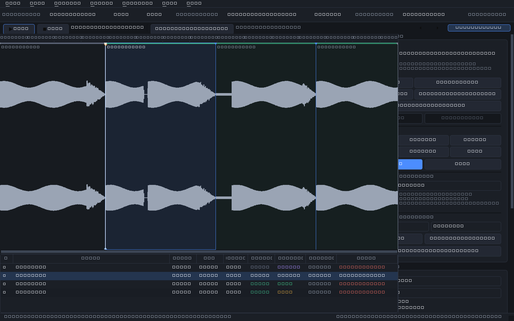
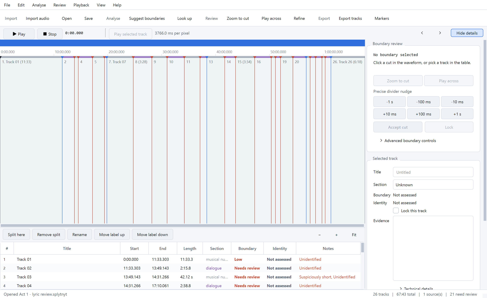

# SplytNyt

**Split long audio recordings into named, tagged tracks — locally, on your own machine.**

SplytNyt takes a long recording — a full concert, a vinyl rip, a DJ mix, a cast
recording from the theatre — and works out where one track ends and the next
begins. It suggests the splits, shows you the evidence behind every suggestion,
lets you correct them by hand, and then exports each track as a properly tagged
audio file.

It runs entirely on your computer. Your recordings are never uploaded. There is no
account, no subscription and no paid service.



> **Status: public beta (v0.1.0-beta).** The application works and is tested,
> but automatic detection is not perfect. Please read
> [What this beta does not do](#what-this-beta-does-not-do) before you rely on
> it for a long evening's work.

---

## What it does

| | |
|---|---|
| **Import** | One or more files into a single ordered timeline. Explicit gaps and overlaps between files are preserved, never silently removed. |
| **Waveform** | Zoomable, multi-resolution, with draggable boundary markers. One lane per channel, track numbers and names on the regions, and a selected boundary drawn differently from the playhead. |
| **Automatic track splits** | Adaptive silence detection plus musical-change detection, with conservative / balanced / sensitive presets. Every proposal comes with the evidence that produced it. |
| **Drag boundaries** | Place, drag, nudge (10 ms / 100 ms / 1 s), split and merge. Boundaries are shared between neighbours, so the two tracks always meet at exactly one frame and the total audio never changes. |
| **Song identification** | Matches detected segments against metadata from MusicBrainz, AcoustID (Chromaprint), LRCLIB and — optionally — setlist.fm. A pasted tracklist works with no network and no API key at all. |
| **Theatre mode** | A separate segmentation mode for musical-theatre recordings: it tells a musical number from dialogue, from an instrumental transition, from applause and from speech over music. |
| **Export** | **WAV**, **FLAC** and **MP3** with tags, plus a **CUE** sheet for a single continuous file. Filename templates with collision protection, marker export/import (JSON, CSV, Audacity labels), optional M3U, a plain-text info file and SHA-256 checksums. |
| **Undo / redo** | Every change is undoable. Autosave, crash recovery and portable `.splytnyt` project files. |
| **Manual correction** | Anything the detector got wrong can be fixed by hand, and the correction is undoable too. |

### The workflow

```
Import  ->  Analyse  ->  Match metadata  ->  Review  ->  Export
```

**Review is where the work happens.** The panel beside the waveform holds
everything needed to judge one cut: where it is, what the evidence was in plain
language, the numbers behind that in an expandable panel, and the controls to
move, accept or lock it.

The waveform, the playback, the displayed times and the export all use the same
frames: "play the next track" starts at exactly the frame that track is
exported from.

Removing a track never removes audio — it is merged into a neighbour. Exporting
never writes over a source recording, even when the output folder contains it.

---

## Installing

### Windows (recommended)

Download the installer from the
[Releases page](https://github.com/dazzlejacket/SplytNyt/releases) — for this
beta that is
[`SplytNyt-0.1.0-beta-setup.exe`](https://github.com/dazzlejacket/SplytNyt/releases/download/v0.1.0-beta/SplytNyt-0.1.0-beta-setup.exe)
— run it and follow the prompts.

The installer is per-user by default: no administrator rights are required, and
it can be removed from *Settings → Apps → Installed apps*.

**You do not need Python, and you never need to open a command line.**

SplytNyt is a 64-bit Windows application and needs Windows 10 or newer.

A `checksums.sha256` file sits beside the installer. To check what you
downloaded:

```powershell
Get-FileHash .\SplytNyt-0.1.0-beta-setup.exe -Algorithm SHA256
```

The installer is not code-signed, so Windows SmartScreen may warn about it the
first time. Choose *More info → Run anyway* if you trust the download, or
verify the checksum above first.

### Building from source

```bash
git clone https://github.com/dazzlejacket/SplytNyt.git
cd SplytNyt
python -m venv .venv
# Windows:        .venv\Scripts\activate
# macOS / Linux:  source .venv/bin/activate
pip install -r requirements.txt
python -m splytnyt.main
```

Python 3.11 or newer. The core dependencies (PySide6, NumPy, SciPy, soundfile,
lameenc, sounddevice) all ship wheels for Windows, macOS and Linux. Everything
runs on the CPU; no GPU and no proprietary service is required.

To try it without using any of your own files:

```bash
python scripts/build_demo.py     # writes a synthetic demo recording
python scripts/ui_exercise.py    # drives the real interface and writes screenshots
```

---

## Where the cuts go

This is the part that matters most, so it is worth being precise about it.

The detector answers **two separate questions**:

1. *Where does the recording change?* — it finds a **transition region**: a
   stretch of quiet, or a musical change.
2. *Where inside that region does the cut belong?* — it looks for the next
   credible **musical onset** and puts the cut just before it.

The default answer to the second question is **near the start of the next song**,
with a **30 ms margin** in front of the music so the first note is never
clipped. The quiet, the applause and the room noise between two songs stay at
the end of the **previous** track.

The margin is yours to change, and it always has a stated scope: **this cut** or
**new suggestions**.

| Choice | The cut goes | Use it when |
|---|---|---|
| **Near next song start** (default) | just before the next musical onset | always, unless you have a reason |
| **Near previous song end** | where the previous song stopped | the quiet belongs to the song before |
| **Middle of gap** | the middle of the quiet | you want the old behaviour |
| **Manual** | where you put it | the detector is wrong |

Nothing is deleted, no silence is inserted and no fades are added: an
unprocessed lossless export reproduces the original PCM **bit for bit**.

The detector refuses to guess in several cases, and says why:

* **A quiet passage inside a song is not a boundary.** The music before the
  passage and the music after it are compared; when it is the same music, and
  the passage still holds quiet music of its own, there is nothing to cut.
* **Applause is not silence, and not the song.** Where the material after a gap
  cannot be told apart from applause, the cut is offered but marked **Needs
  review**.
* **A transition without a break** (a medley) is reported as an uncertain
  transition and reviewed by ear.
* **Moving a boundary moves the previous track's end with it**, so the two
  tracks always meet at one frame and the total audio never changes.

---

## Identifying songs

Identification is optional in every direction: SplytNyt works without any of it.

| Provider | Needs a key? | Notes |
|---|---|---|
| **MusicBrainz** | no | Album and release lookup. |
| **AcoustID** | no | Chromaprint fingerprinting of the audio itself. Needs `ffmpeg` (with the `chromaprint` muxer) or `fpcalc` on your `PATH`. |
| **LRCLIB** | no | Synchronised lyrics, used as matching evidence. |
| **setlist.fm** | **yes — your key** | Concert lookup: the songs, the sets, the encores and the artist's own notes. |
| **ShazamIO (Experimental)** | no | Optional, unofficial, opt-in. See below. |
| **Pasted tracklist** | no | Works entirely offline. |

### The AcoustID application key

SplytNyt ships with its own registered **AcoustID application key** built in, so
fingerprint lookup works out of the box and you do not have to register for
anything. This is an application key issued to the project, not a personal key.

### The setlist.fm key is yours

**No personal setlist.fm API key is included in this repository or in any
release artefact.** setlist.fm requires every user to have their own key:

1. Register for a free key at [setlist.fm/api](https://www.setlist.fm/api).
2. Enter it in SplytNyt under **Settings → Music Services**.

The key is stored in the **Windows Credential Manager**, not in a settings file,
not in the project and not in the source code. You can also supply it through
the `SETLISTFM_API_KEY` environment variable, which takes precedence.

The same screen accepts an optional AcoustID override if you would rather use
your own key than the built-in one.

---

## ShazamIO (Experimental)

SplytNyt can use **ShazamIO** as an optional song-recognition engine.

* It is **disabled by default**. You have to turn it on yourself in
  **Settings → Music Services**.
* It is **never bundled** in the release build.
* It is **unofficial**: it talks to Shazam's unofficial online recognition
  service, which has no API key, no service agreement and no guarantee. It may
  rate-limit you, or stop working without notice.
* Installing it needs **no Python and no command line**: the app downloads the
  official MIT-licensed wheels from PyPI, verifies their SHA-256 digests and
  extracts them into your own user folder. You can uninstall it again from the
  same screen.
* If ShazamIO is disabled, missing or broken, **SplytNyt behaves exactly the
  same** — every other feature keeps working.

Please read Shazam's terms before enabling it, and do not use it to identify
recordings you are not entitled to identify.

---

## Musical-theatre recordings

**Analyse → Theatre segmentation** is a second way to segment a recording, for a
show rather than for a concert. It runs in three passes, and each one can be
switched off:

1. **Classify.** The recording is read in blocks and handed to a small trained
   audio-event classifier that says where there is music, where there is speech,
   where there is applause and where there is silence.
2. **Transcribe** (optional). The whole recording is transcribed locally. The
   result is *evidence*: it tells the classifier where the spoken words are, and
   it is shown to the reviewer. A line the model made up is thrown away rather
   than believed.
3. **Assemble.** The scores become overlapping activity regions, and then into
   sections: a musical number, dialogue, an instrumental transition
   (underscoring), applause, speech over music, or an uncertain stretch.

The rules that matter:

* **Activities overlap.** A stretch of dialogue played over the band holds a
  *speech* activity and an *instrumental* activity at the same time. The
  detector never has to choose between "speech" and "music"; it reports both.
* **The boundaries come from the spoken words and the applause**, not from the
  music. In a stage recording the orchestra plays through almost everything, so
  the edges that mean something are where the words start and stop, and where
  the audience applauds.
* **A song is not cut at every line.** Words found over a band that is playing
  at full volume are treated as lyrics. They are evidence that there is a voice,
  and they do not cut the music.
* **Nothing is invented.** A number that the reference list does not know about
  stays unnamed. Both ends of a mismatch are reported.

The optional models are downloaded on demand into `~/.splytnyt/models`, and the
size of every download is shown before it starts:

| Model | Size | What it is for |
|---|---|---|
| YAMNet (ONNX) | 16.1 MB | the audio-event classifier |
| Whisper *small* (int8, CPU) | 486 MB | the speech evidence |

Without them the application still runs, and falls back to acoustic measurements
alone. The models are never bundled into the executable, and **no recording is
ever uploaded** — the downloads fetch model files only, and your audio stays on
the machine.

---

## Export

Two export profiles, and nothing happens behind your back:

* **Complete performance** writes every stretch, so no audio is lost.
* **Songs only** writes the musical numbers and reports every exclusion with
  its reason and the time left out.

Output formats are **WAV**, **FLAC** and **MP3**, each with tags (Vorbis
Comments, ID3v2.4 and RIFF INFO are written by this project directly), plus a
**CUE** sheet when you export one continuous file. Export also writes SHA-256
checksums and verifies every FLAC it produced.



---

## Levels

Four choices, and nothing happens behind your back:

1. **Untouched.**
2. **Shared gain** for the whole recording.
3. **Loudness normalisation** to a target (BS.1770-4 integrated loudness).
4. **Per-track normalisation**, clearly distinct from a whole-recording gain.

True peak is measured on a 4x oversampled signal. If a target cannot be reached
under the true-peak ceiling, the interface says exactly why and asks you to
choose: less gain, or an **explicitly** enabled limiter. SplytNyt never
silently limits, compresses, denoises, declicks or resamples.

---

## Keyboard shortcuts

| | | | | |
|---|---|---|---|---|
| `Space` | Play / pause | `Esc` | Stop |
| `←` `→` | Move the cursor | `Enter` | Play across the selected cut |
| `Z` | Zoom to the selected cut | `Ctrl`+`[` `Ctrl`+`]` | Previous / next uncertain cut |
| `[` `]` | Nudge the cut by 10 ms | `Shift`+`[` `Shift`+`]` | Nudge by 1 second |
| `S` | Split at the cursor | `M` | Merge with the previous track |
| `Backspace` | Remove the track (audio is kept) | `L` | Lock / unlock the selected track |
| `A` | Accept all suggestions | `Ctrl`+`R` | Suggest boundaries |
| `Ctrl`+`T` | Paste a tracklist | `Ctrl`+`L` | Align with the tracklist |
| `Ctrl`+`Shift`+`R` | Theatrical segmentation | | |
| `Ctrl`+`Z` | Undo | `Ctrl`+`Shift`+`Z` | Redo |
| `Ctrl`+wheel | Zoom at the pointer | `0` | Zoom to fit |
| `F1` | Every shortcut | | |

---

## What this beta does not do

Being straight with you about the limits of this release:

* **Automatic detection is not perfect.** The cut suggestions are a strong
  starting point, not a finished answer. Some recordings will need every cut
  moved by hand.
* **Live concert recordings usually need manual correction.** Audience noise,
  a chatty crowd, a long encore, an extended guitar intro or a talkative
  singer all defeat a purely acoustic decision. SplytNyt marks these cuts
  **Needs review** rather than pretending to be sure — but it will get some of
  them wrong.
* **The speech recogniser is not deterministic.** Running the transcriber on
  multiple threads can return slightly different transcripts for the same
  audio on different runs, and in theatre mode the cut points follow the
  transcript. The audio-event classifier *is* deterministic.
* **ShazamIO is unofficial and optional.** It uses an online service with no
  API key, no agreement and no guarantee. It is off by default and is not
  bundled. It may rate-limit you or stop working.
* **AcoustID fingerprinting needs a local helper.** `ffmpeg` (with the
  `chromaprint` muxer) or `fpcalc` must be installed and on your `PATH`.
* **Reading tags already embedded in your source files is not available in the
  packaged Windows build.** That feature needs Mutagen, which is GPL-2.0, so it
  is deliberately left out to keep this application MIT-licensed. SplytNyt's own
  tag *writers* are unaffected. If you run from source you can `pip install
  mutagen` yourself and get the extra behaviour.
* **Only Windows was built and tested.** The code is the same everywhere, but
  no macOS or Linux build was produced or run.
* **The accuracy of automatic splitting on real recordings is not measured.**
  The test suite verifies the detector's behaviour against synthetic material
  with known ground truth; it does not tell you how often the detector is right
  about your particular concert recording.

### No copyrighted material is included

This repository and every release artefact contain **no copyrighted recordings**,
no sample audio, no lyrics and no transcripts. The test suite builds its own
synthetic material. The theatrical reference list contains only factual
metadata (number titles, order and approximate durations) with its sources
listed.

Your own recordings stay yours: SplytNyt reads them, never uploads them, and
never writes over them.

---

## Third-party components

| Component | Licence | Used for |
|---|---|---|
| PySide6 (Qt 6) | LGPL v3 | the interface |
| libsndfile via `soundfile` | LGPL v2.1 | decoding and lossless encoding |
| LAME via `lameenc` | LGPL v2.1 | MP3 encoding |
| NumPy, SciPy | BSD 3-Clause | DSP |
| PortAudio via `sounddevice` | MIT | playback |
| onnxruntime | MIT | running the audio-event classifier (optional) |
| faster-whisper / CTranslate2 / tokenizers / huggingface-hub | MIT / MIT / Apache-2.0 / Apache-2.0 | local speech recognition (optional) |
| CPython | PSF | the runtime |

The tag writers (Vorbis Comments, ID3v2.4, RIFF INFO) are written in this
project rather than taken from Mutagen, because Mutagen is GPL-2.0-or-later and
linking it would impose that licence on the application. The release build
therefore excludes Mutagen entirely.

Full licence texts for everything above are in [`licenses/`](licenses/), and
[`THIRD_PARTY_NOTICES.md`](THIRD_PARTY_NOTICES.md) lists each component with its
licence and the source it came from. The Windows installer places a copy of
that folder next to the application.

The LGPL-licensed components (Qt, libsndfile, LAME) are used through their
separate shared libraries. You are free to replace those libraries with your
own builds, and nothing in SplytNyt prevents it.

---

## Project layout

```
splytnyt/
  core/        pure data model - no Qt, no audio, no numpy
  audio/       decode, peaks, measurement, gain, encoders, tags, playback
  analysis/    onset detection, boundary placement, classification, alignment
  metadata/    the optional providers: MusicBrainz, AcoustID, LRCLIB, setlist.fm
  app/         session, background jobs, export orchestration
  ui/          PySide6 widgets
docs/          architecture notes and screenshots
scripts/       build scripts and the Windows installer definition
tests/         the test suite
```

The layering is enforced: `core` imports nothing from the layers above it,
`audio` and `analysis` never import `ui`, and `ui` calls `app` for the
providers and the encoders. The service layer is free of Qt, so it can be
tested without a display.

## Development

```bash
pip install -r requirements-dev.txt
python -m pytest
```

The test suite is offline: it uses recorded provider responses as fixtures and
synthesises its own audio, so it never touches the network and never needs a
recording of your own.

To build the Windows application and the installer:

```bash
python scripts/build_windows.py --clean
# then, with Inno Setup 6 installed:
"C:\Program Files (x86)\Inno Setup 6\ISCC.exe" scripts\installer\SplytNyt.iss
```

See [`CONTRIBUTING.md`](CONTRIBUTING.md) for the full workflow.

## Licence

MIT — see [`LICENSE`](LICENSE).

The AcoustID application key built into the application is registered to the
SplytNyt project. Please do not abuse it: AcoustID asks for three requests per
second, and SplytNyt stays well inside that.

## Reporting a problem

Please use the [issue templates](https://github.com/dazzlejacket/SplytNyt/issues/new/choose).
If you can, attach the `.splytnyt` project file (it is small and contains no
audio) rather than the recording itself — **please never attach copyrighted
recordings to a public issue.**
